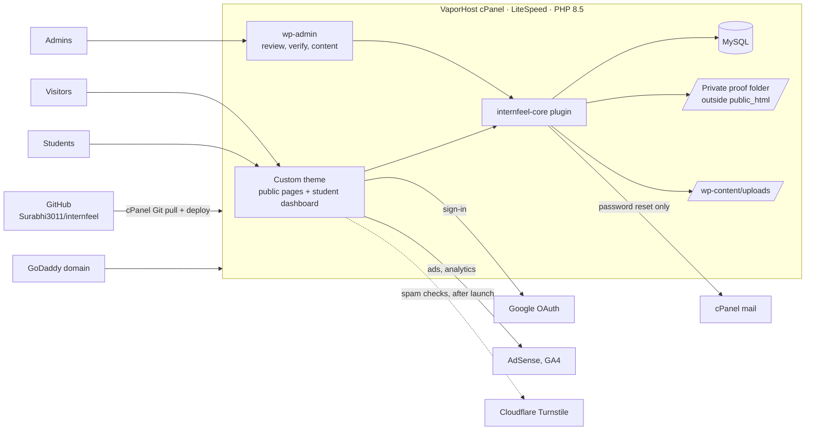
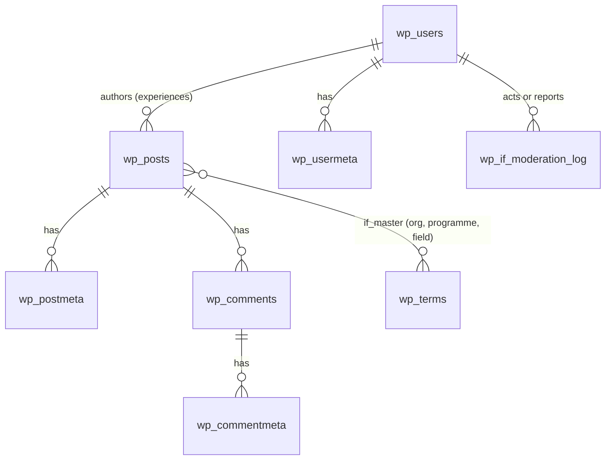
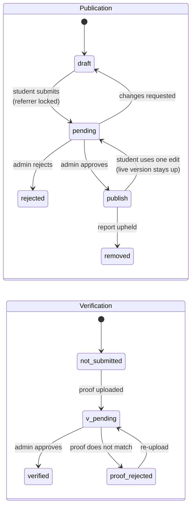
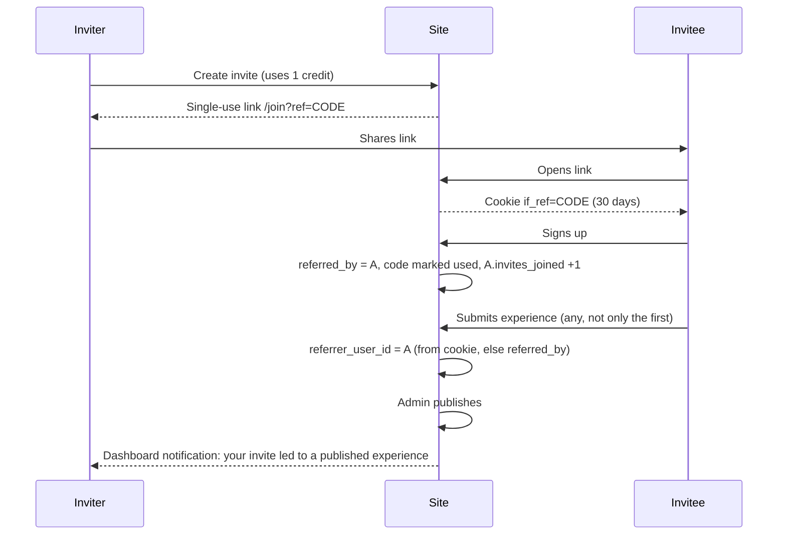

# InternFeel architecture

**Status:** approved for build, 25 October 2026
**Owners:** Surabhi Gupta, Arjit Raj
**Related:** [plan.md](plan.md) (scope, schedule, decisions) · [development.md](development.md) (how to build, test and deploy)

InternFeel is a fresh WordPress 7.0 site on PHP 8.5, hosted on the existing VaporHost cPanel plan. All custom behaviour lives in two pieces of code kept in GitHub: a custom theme for every page visitors and students see, and one plugin, `internfeel-core`, for accounts, submissions, verification, invites, badges, certificates and moderation. Nothing from the old WordPress install is reused except its exported content.

---

## 1. Why WordPress on VaporHost

| Option considered | Outcome |
| --- | --- |
| Next.js + Supabase on Vercel | Rejected: Vercel's free plan forbids sites that show ads, and it adds three new services to run. |
| Next.js on Cloudflare Workers | Rejected: the team prefers to stay on the hosting already paid for. |
| Node.js on VaporHost | Not possible: the cPanel plan has no "Setup Node.js App". |
| **Fresh WordPress on VaporHost** | **Chosen.** PHP 8.5 is available and fully supported by WordPress 7.0. Users, roles, comments, the admin panel, media and SEO come built in. |

The cost of this choice is that security becomes our job, which is covered in section 9.

---

## 2. System overview



- **Students never open wp-admin.** Their dashboard is a page in the theme, backed by the plugin's REST endpoints.
- **Admins** (Surabhi and Arjit) use wp-admin for moderation, verification, listicles and content.
- **Every outside service is on a free plan:** Google sign-in, AdSense and GA4. A CAPTCHA (Cloudflare Turnstile) is deferred until after launch.
- **No notification emails.** Every update (review outcomes, verification, comments, invites) appears as a notification on the student's dashboard. The site sends one email only: WordPress's password-reset link, through the hosting's own mail.

---

## 3. Components

### 3.1 Custom theme: `wp-content/themes/internfeel`

A classic PHP theme with hand-written templates and no page builder. Design brief: keep the current logo and teal, and make it modern, clean and minimal.

| Template | Purpose |
| --- | --- |
| `front-page.php` | Home: hero search, filters, trust strip, listicle rows, how it works, invite banner |
| `single.php` | Experience page: key-facts box, story, ratings, referral credit, share buttons, comments, ad slots |
| `archive.php`, `search.php` | Filtered and searched results, with filters reflected in the URL |
| `taxonomy-if_master.php` | Organisation and programme hub pages |
| `single-if_list.php`, `archive-if_list.php` | Listicles |
| `page-dashboard.php` | Student dashboard with tabs: My experiences, Comments, Invites, Profile |
| `page-signup.php`, `page-login.php` | Email-and-password sign-up and sign-in, Google button, forgotten-password link |
| `page-submit.php` | Four-step submission form |
| `page-join.php` | Invite landing page; sets the referral cookie |
| `page-verify.php` | Public certificate check |
| `header.php`, `footer.php` | Header and footer as specified in plan.md |
| `inc/ads.php` | Fixed AdSense slots and their rules |

Front-end JavaScript is plain ES modules with no build step. CSS uses custom properties for the design tokens (teal, neutrals, type scale, spacing).

### 3.2 Plugin: `wp-content/plugins/internfeel-core`

| Module | Responsibility |
| --- | --- |
| `Content` | Relabels posts as Experiences; registers the `if_master` taxonomy, the `if_list` post type and the `rejected` and `removed` statuses |
| `Fields` | Registers and validates every experience meta field; exposes the public ones to REST |
| `Auth` | Email-and-password sign-up and sign-in on theme pages, password reset, the student role, wp-admin lock-out, profile fields, under-18 flag |
| `Submit` | Submission and edit-once handling, drafts with autosave, server-side validation |
| `Verify` | Proof upload into private storage, a permission-checked download, admin decisions |
| `Invites` | Invite credits, single-use codes, the `/join` cookie, referral attribution |
| `Badges` | `verified_count` and badge rendering |
| `Certificates` | PDF generation (Dompdf), certificate numbers, QR verify page, revocation |
| `Views` | View counter endpoint and per-day cookie |
| `Comments` | Edit-once rule, reports, flagging |
| `Moderation` | Review queue screens, the moderation log table, the 24-hour SLA highlight |
| `Notify` | Dashboard notifications (the bell in the header and the dashboard list); no notification emails |
| `Import` | One-time importer for the exported legacy content |
| `Hardening` | Disables XML-RPC, closes the users REST route, disables file editing, adds security headers |

### 3.3 Free third-party plugins (kept to a minimum)

| Plugin | Purpose |
| --- | --- |
| LiteSpeed Cache | Page and object caching, image optimisation (WebP/AVIF) |
| Wordfence | Firewall, malware scan, login protection |
| Two-Factor | Two-step sign-in for administrators |
| Yoast SEO | Titles, meta descriptions, sitemaps, schema |
| Nextend Social Login | "Sign in with Google" |
| CookieYes | Cookie consent; a Google-certified consent platform, needed for AdSense in the EEA and UK |
| Simple Cloudflare Turnstile | **After launch.** Spam checks on sign-up, submission and comment forms. Until then, the plugin's rate limits and a hidden honeypot field stop simple bots |
| UpdraftPlus | Daily database and weekly files backups to Google Drive |

---

## 4. Data model

The approved design has five parts. Four map onto WordPress's own tables; only the moderation log is a custom table.



### 4.1 users: WordPress users and user meta

| Role | Who | Access |
| --- | --- | --- |
| `administrator` | surabhigupta, arjitraj | wp-admin and the moderation module; Admin link in the header |
| `if_student` | Everyone who signs up | Front end only; redirected away from wp-admin; no admin bar |
| `if_archive` | One system user, "InternFeel Archive" | Owns migrated experiences until claimed |

User meta, all prefixed `_if_`:

| Key | Type | Notes |
| --- | --- | --- |
| `_if_college`, `_if_course`, `_if_graduation_year` | string, string, int | Asked at first sign-in |
| `_if_linkedin_url`, `_if_avatar_id` | string, int | Optional |
| `_if_is_under_18` | bool | Asked at first sign-in; drives non-personalised ads and the 2027 parental-consent step |
| `_if_referral_code` | string | Unique per student |
| `_if_referred_by_user_id`, `_if_referred_at` | int, datetime | Set once at sign-up from the invite cookie |
| `_if_invite_credits` | int | Never below 0 |
| `_if_invite_codes` | JSON array | Entries `{code, sent_to, sent_at, used_by, used_at}`; each code is single use and never expires |
| `_if_invites_joined` | int | Counter |
| `_if_verified_count` | int | Counter; drives badges |
| `_if_notifications` | JSON array | Latest 100 entries `{type, message, link, created_at, read}`; drives the header bell and the dashboard list |

### 4.2 master_list: the `if_master` taxonomy

One hierarchical taxonomy is the single source for every dropdown, filter and hub page. Organisations are top-level terms, programmes are their child terms, and fields of study are top-level terms with `kind = field`.

| Term meta | Values |
| --- | --- |
| `_if_kind` | `organisation`, `programme` or `field` |
| `_if_org_type` | company, institute, government or NGO (organisations only) |
| `_if_city`, `_if_country` | Location (organisations) |
| `_if_recurring` | bool (programmes held every year) |
| `_if_active` | bool; terms in use are deactivated, never deleted |

Only admins create terms. Students choose from the list, or type a new organisation that goes to the review queue as a suggestion.

### 4.3 experiences: the built-in post type, relabelled

Experiences use WordPress's built-in **post** type, relabelled "Experiences" in wp-admin. A custom post type was considered and rejected: the old site's URLs are `/post-slug/` at the root, and only the built-in post type keeps those permalinks natively, without redirects or rewrite tricks. That matches the decision not to build redirects.

| Native field | Use |
| --- | --- |
| `post_title`, `post_name` (slug), `post_author`, `post_date` | As normal; migrated posts keep their original slug and date |
| `post_content` | The story as HTML. For new submissions it is generated from the standard Q&A answers; migrated posts keep their cleaned original HTML. |
| `post_excerpt` | A one-line summary for cards |
| `post_status` | `draft`, `pending` (in review), `publish`, `rejected` (custom), `removed` (custom) |
| Featured image | Photo shown on cards and the share image |

Post meta (prefix `_if_`; the leading underscore hides it from the custom-fields box):

| Group | Keys |
| --- | --- |
| Where and what | `organisation_term`, `programme_term`, `field_term` (if_master term IDs), `type` (research, industry, government, NGO, virtual), `mode` (on-site, remote, hybrid), `city`, `country`, `start_month` (YYYY-MM), `duration_weeks` |
| Money | `paid` (required, bool), `stipend_amount_inr` (optional, monthly), `selection_difficulty` (1–5) |
| Story | `story` (JSON keyed by the standard questions), `advice` |
| Ratings (required) | `rating_overall`, `rating_learning`, `rating_mentorship`, `rating_culture` (1–5) |
| Identity | `is_anonymous` (hides name, photo and LinkedIn only) |
| Referral | `referrer_user_id` (set once at submission), `invite_code` |
| Counters | `view_count`, `report_count`, `flagged` |
| Verification (private) | `proof_files` (JSON list of private file names), `verification_status` (not_submitted, pending, verified, rejected), `verified_by`, `verified_at`, `verification_note` |
| Certificate | `certificate_no`, `certificate_issued_at`, `certificate_revoked_at` |
| Editing | `edit_count` (max 1 after publishing) |
| Legacy | `legacy_wp_id`, `legacy_student_name`, `legacy_published_year` |

**Private meta never leaves the server.** `proof_files`, `verification_note` and `verified_by` are registered with `show_in_rest => false`, and the theme never prints them.

### 4.4 comments: native WordPress comments

Threaded one level deep. Comment meta: `_if_edited_at`, `_if_edit_count` (max 1), `_if_report_count`, `_if_flagged`. Migrated comments keep their original author name in the native `comment_author` field.

### 4.5 moderation_log: custom table `{prefix}if_moderation_log`

```sql
CREATE TABLE {prefix}if_moderation_log (
  id           BIGINT UNSIGNED AUTO_INCREMENT PRIMARY KEY,
  actor_id     BIGINT UNSIGNED NOT NULL,          -- admin, or reporting reader
  target_type  VARCHAR(20)  NOT NULL,             -- experience | comment | user | proof | referral
  target_id    BIGINT UNSIGNED NOT NULL,
  action       VARCHAR(40)  NOT NULL,             -- approve, reject, request_changes, verify, reject_proof,
                                                  -- remove, restore, report, remove_referral, ...
  reason       VARCHAR(255) NULL,
  note         TEXT NULL,
  created_at   DATETIME NOT NULL,
  KEY target (target_type, target_id),
  KEY actor  (actor_id, action)
);
```

It stores every admin decision and every reader report. A reader can report the same item only once, which is checked against this table.

### 4.6 Supporting objects

| Object | Storage |
| --- | --- |
| Listicles | Post type `if_list` (admin only): title, intro, an ordered list of experience IDs, a home-page order |
| Certificates | PDF files in the private folder; the record is the experience meta above |
| Sponsored ads (after relaunch) | Tables `if_advertisers`, `if_ad_campaigns`, `if_ad_events`, as specified in plan.md |

---

## 5. Key flows

### 5.1 Experience lifecycle

Publication and verification are two separate tracks, so a story is never held back while proof is checked.



What happens on each transition:

| Event | Effects |
| --- | --- |
| Submit | Validate required fields; set `referrer_user_id` once; status becomes `pending`; appears in the admin review queue |
| Approve (publish) | Issue certificate; show referral credit; notify the student and the referrer on their dashboards |
| Published **and** verified (whichever comes second) | `verified_count` +1 on the author (badges); author gets **3 invite credits** |
| One edit after publishing | Saved as a pending revision; the live version stays until an admin approves it; `edit_count` becomes 1 |
| Remove | Certificate revoked; credits already granted are kept; logged |

### 5.2 Sign-in

- **Email and password:** sign-up and sign-in forms on theme pages (`/signup/`, `/login/`), using WordPress's own password handling. There is no email verification step. Both forms are protected by rate limits and a hidden honeypot field; a CAPTCHA (Turnstile) is added after launch.
- **Google:** handled by Nextend Social Login, then the same profile-completion step. Students who joined with Google can add a password later in Profile.
- **First sign-in** asks for name, college, course, graduation year and the under-18 question.
- **Forgotten password:** WordPress's built-in reset email, sent through the hosting's mail. It is the only email the site sends. Admins can also reset a password from wp-admin.
- **Trade-off:** without email verification, someone could sign up with an email they don't own. Rate limits, the honeypot and the review of every experience before publishing keep the impact small.

### 5.3 Invites and referral credit



- **Credit line on the post:** "Shared through an invite from {referrer name}, {college}". It appears even when the author is anonymous; only the author is hidden.
- **Abuse rules:** self-referral is blocked; sign-ups from the inviter's own IP or device within 24 hours are flagged for review; invites are limited to credits held; an admin can remove a credit, and the removal is logged.

### 5.4 Badges

One badge symbol per verified experience, shown next to the student's name on the dashboard, beside their comments and on their named posts. Above 10, the name shows 10 symbols and the number. Anonymous posts show no badge. Invites never earn badges.

### 5.5 Certificates

- **Issued on publish.** Dompdf renders the template with the student's real name, experience title, organisation, date, certificate number (`IF-YYYY-NNNNN`) and a QR code linking to `/verify/IF-YYYY-NNNNN`. Footer: "Issued by InternFeel".
- **Storage and download:** the PDF is stored in the private folder, and the student downloads it from the dashboard through a permission-checked endpoint.
- **Removal:** if the experience is removed, the verify page shows "revoked".

### 5.6 View counting

- **Why it runs in JavaScript:** LiteSpeed serves cached pages without running PHP, so the count can't happen in a template. A small script on each experience page calls `POST /wp-json/internfeel/v1/view/{id}`.
- **What the endpoint skips:** bots (by user agent), the author, and repeat visits from a browser that already holds the `if_v_{id}` cookie (one day).
- **How it counts:** an atomic SQL `UPDATE` on `view_count`, so simultaneous visits don't lose counts.
- **Trade-off:** with no per-day history stored, dashboards show total views only.

### 5.7 Search and filters

- **One query:** `WP_Query` combining full-text search, `if_master` term filters, and meta filters for type, year, paid or unpaid, stipend band and verified-only.
- **Shareable results:** filters live in the URL query string, so any filtered view can be shared and cached.
- **Live updates:** results refresh through `GET /wp-json/internfeel/v1/experiences` without a page reload.
- **Scale:** fine for a few thousand experiences. Beyond that, add a dedicated search index.

### 5.8 Moderation

- **Queues:** a wp-admin page lists submissions, proofs, edits, reports and organisation suggestions, oldest first. Anything waiting more than 18 hours is highlighted, against the 24-hour promise.
- **Auto-flagging:** an item with 3 reports is hidden from listings until an admin decides.

---

## 6. Public interfaces

### 6.1 URLs

| URL | Page |
| --- | --- |
| `/` | Home |
| `/{experience-slug}/` | Experience (the same URLs as the old site) |
| `/experiences/?field=&type=&org=&year=&paid=&stipend=&verified=` | Filtered list |
| `/org/{organisation}/`, `/org/{organisation}/{programme}/` | Hub pages |
| `/lists/{listicle}/` | Listicle |
| `/signup/`, `/login/`, `/submit/`, `/dashboard/`, `/join/?ref=CODE`, `/verify/{certificate_no}` | Student flows |
| `/about/`, `/contact/`, `/privacy-policy/`, `/terms/`, `/content-guidelines/` | Static pages |

### 6.2 REST API (`/wp-json/internfeel/v1/`)

| Method and route | Who | Purpose |
| --- | --- | --- |
| `GET experiences` | Anyone | Filtered listing |
| `POST view/{id}` | Anyone | Count a view |
| `POST auth/signup`, `POST auth/login` | Anyone (rate-limited, honeypot) | Create an account; sign in |
| `GET/POST me`, `GET me/stats` | Student | Profile and dashboard counters |
| `GET me/notifications`, `POST me/notifications/read` | Student | Notification list; mark as read |
| `POST experiences`, `PATCH experiences/{id}` | Student (own) | Draft, submit, one edit |
| `POST experiences/{id}/proof`, `GET proof/{file}` | Author or admin | Upload proof; download it after a permission check |
| `GET certificates/{id}.pdf` | Author | Download certificate |
| `GET verify/{certificate_no}` | Anyone | Certificate status |
| `POST invites`, `GET invites` | Student | Create invite links; list invites |
| `POST report` | Signed-in user | Report an experience or comment |
| `PATCH comments/{id}` | Comment author | One edit |
| `POST moderation/{action}` | Admin | Review actions (wp-admin UI) |

All write routes need a WordPress nonce and a capability check.

---

## 7. Hosting and environments

| Environment | Where | Notes |
| --- | --- | --- |
| Production | `internfeel.com`, `public_html` on VaporHost | LiteSpeed, PHP 8.5, free SSL (AutoSSL) |
| Staging | `staging.internfeel.com`, folder `public_html/staging.internfeel.com` on the same plan | Its own database; password-protected through cPanel Directory Privacy; `noindex` |
| Development | Claude Code workspace and contributors' machines | WordPress Playground CLI or wp-env; see development.md |

- **Domain:** registered at GoDaddy. DNS records sit wherever its nameservers point (GoDaddy, or the VaporHost Zone Editor).
- **DNS** for internfeel.com is managed in the VaporHost cPanel **Zone Editor**.
- **Email:** the public inbox `contact@internfeel.com` is cPanel mail. The only email the site sends, the password reset, goes out from `no-reply@internfeel.com` through cPanel mail, with SPF and DKIM set in cPanel's Email Deliverability.
- **Private storage:** `/home/<cpanel-user>/internfeel-private/{proofs,certificates}`, outside `public_html`, with `0750` folders and `0640` files.
- **Deploys:** cPanel Git Version Control pulls the public repo `Surabhi3011/internfeel` over HTTPS and copies the theme and plugin through `.cpanel.yml` (development.md, section 6). No SSH is needed, and no secrets or private details are ever in the repo.

---

## 8. Third-party services

| Service | Plan | Used for | Limit to watch |
| --- | --- | --- | --- |
| Google Cloud (OAuth) | Free | Sign in with Google | Basic scopes only |
| Google AdSense | Free | Ads in fixed slots | Max 3 units per page |
| Google Analytics 4 | Free | Traffic | Loads only after consent |
| Cloudflare Turnstile | Free, after launch | Spam checks | None at this scale |
| Google Drive (UpdraftPlus) | Free | Backups | 15 GB |
| Razorpay | After relaunch | Sponsored-ad payments | Needs the registered business details |

---

## 9. Security

The old install was probably compromised, so the new site starts clean and stays locked down.

1. **Clean slate.** Fresh WordPress, no files from the old install, new database, new salts, new admin accounts. Once its content is exported, the old install is removed from the hosting account and the cPanel password is changed.
2. **Least privilege.** Students hold only `read` plus custom capabilities for their own content. The plugin checks ownership on every write.
3. **Admin protection.** Two-step sign-in, Wordfence login limits, no `admin` username.
4. **Private files.** Proofs and certificates live outside the web root and are streamed only after a permission check, with `Content-Disposition: attachment`. Uploads accept only PDF, JPG and PNG, up to 5 MB, maximum 3 files, checked by real MIME type.
5. **Hardening, in the plugin and wp-config.** `DISALLOW_FILE_EDIT`, XML-RPC off, `/wp/v2/users` closed to the public, author-enumeration redirects blocked, and security headers set: `X-Content-Type-Options`, `Referrer-Policy`, `X-Frame-Options`, and a starter Content-Security-Policy.
6. **Input and output.** Everything is sanitised on the way in and escaped on the way out. `$wpdb->prepare` is used for all SQL, and nonces protect every form and REST write.
7. **Rate limits** on sign-up, sign-in, password reset, submissions, comments, reports and invites. A hidden honeypot field catches simple bots on the public forms; Turnstile is added after launch. Passwords use WordPress's own hashing, with a minimum length of 8 characters.
8. **Updates.** Automatic minor and plugin updates, and Wordfence malware scans.
9. **Secrets** live only in `wp-config.php` on the server and are never committed (development.md, section 4).

---

## 10. Privacy and compliance

- **India's Digital Personal Data Protection Act, 2023:** the privacy policy is rewritten for it, and students can download or delete their data from Profile.
- **Students under 18 may join.** The Act's children's-data rules, including verifiable parental consent, apply from **13 May 2027**, so a parental-consent step must ship before then. Until then, under-18 students see non-personalised ads only (`requestNonPersonalizedAds`).
- **Proof files** are deleted 90 days after the verification decision; the decision itself is kept in meta and the log.
- **Account deletion** removes personal fields and proofs. Published experiences stay but become anonymous, unless the student asks for them to be removed too.
- **Consent first:** CookieYes blocks GA4 and AdSense until the visitor consents.

---

## 11. Performance and SEO

- **Performance targets:** Lighthouse mobile 90 or above on home, listing and experience pages, with ads on, and Largest Contentful Paint under 2.5 seconds on 4G.
- **Speed measures:**
  - LiteSpeed page cache; dynamic parts (header account menu, counters, dashboard) loaded through REST.
  - WebP/AVIF images with fixed dimensions, and lazy loading below the fold.
  - No page builder and no jQuery on the front end.
  - The AdSense script loads after the page content, and every ad slot reserves its height so the page doesn't jump.
- **SEO:**
  - The experience title is the H1, with a unique Yoast title and description on every page.
  - Article and Review schema on experience pages.
  - The XML sitemap lists only experiences, hubs, listicles and static pages.
  - Dashboard, submit, join and staging pages are `noindex`.

---

## 12. Decisions log

| Date | Decision | Reason |
| --- | --- | --- |
| 25 Oct 2026 | Rebuild rather than repair | Old install probably compromised; outdated stack; Elementor bloat |
| 25 Oct 2026 | WordPress 7.0 on PHP 8.5 at VaporHost | Hosting already paid for; no Node.js on the plan; WordPress fully supports PHP 8.5 |
| 25 Oct 2026 | Experiences use the built-in post type | Keeps the old `/slug/` URLs with no redirects |
| 25 Oct 2026 | Publication and verification are separate tracks | Stories go live without waiting for proof checks |
| 25 Oct 2026 | View count via JavaScript beacon | Page caching would otherwise skip PHP counters |
| 25 Oct 2026 | No redirect table | Pages rebuilt at the same URLs; check Search Console for old category and tag traffic before launch |
| 25 Oct 2026 | Sponsored ads after relaunch | Pricing to be agreed; keeps the 15-day schedule realistic |
| 25 Oct 2026 | Public GitHub repo | The hosting plan has no SSH access, so cPanel can only pull a public repo; secrets and private details are kept out of it |
| 25 Oct 2026 | No CAPTCHA at launch | Deferred by the team; rate limits and a honeypot cover simple bots until Turnstile is added |
| 25 Oct 2026 | Email-and-password or Google sign-in, no email verification, no notification emails | Updates are shown on the dashboard; no Resend account needed. The password reset is the only email, through cPanel mail |
