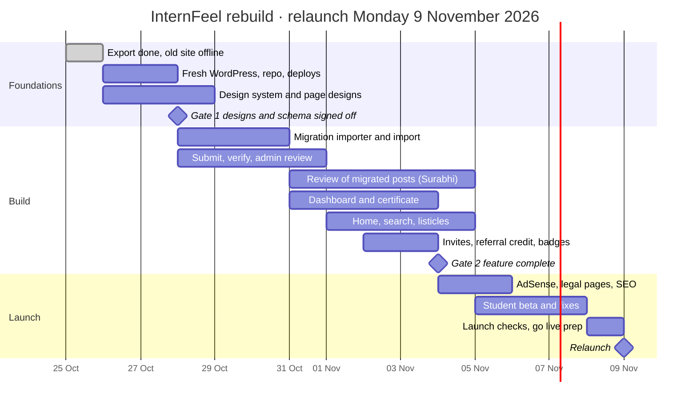

# InternFeel relaunch plan

**Status:** approved, 25 October 2026
**Build window:** Monday 26 October to Monday 9 November 2026 (15 days, built entirely with Claude Code)
**Owners:** Surabhi Gupta (product, content review, admin), Arjit Raj (admin)
**Related:** [architecture.md](architecture.md) · [development.md](development.md)

---

## 1. Background

An audit of internfeel.com on 25 October 2026 found a valuable archive of 217 genuine first-person internship interviews on a neglected site.

- **Outdated software:** WordPress 6.4.8 and Elementor 3.20.1, with four Elementor add-ons and leftover shop and job-board pages.
- **Probable compromise:** a gibberish post appeared on 3 July 2026 and was the first card on the home page.
- **Stale content:** 86% of posts date from 2014–2016, and nothing genuine was published after August 2020.
- **Broken core flows:** submissions went through a Google Form, the paid chat feature showed raw code, and comments needed a login with no way to sign up.
- **Weak SEO:** every post's main heading read "Blog", 453 thin tag pages existed, and test pages were indexed.
- **Slow and unmeasured:** the home page took 4.9 seconds to load, and no analytics were running.
- **Outdated legal pages:** the privacy policy dated from 2018, the terms from 2016, and there was no cookie consent.

The relaunch keeps the brand ("InternFeel", "peep before you leap"), the logo, the teal colour and every genuine interview. Everything else is rebuilt.

## 2. Goals

1. Students can find a relevant experience in two clicks and submit one in under 10 minutes.
2. Every new experience is structured: comparable facts, required ratings and an optional proof check.
3. Contributors are rewarded with a dashboard, view counts, a certificate, badges and invites, so they come back and bring friends.
4. The site is secure, fast, measurable and legally sound from day one.
5. Ads bring in income without spoiling the reading experience.

**Measures after launch:** organic sessions, experiences submitted per month, the share of experiences verified, students joined through invites, and AdSense revenue.

## 3. Scope

### Ships at relaunch (9 November 2026)

1. **Student accounts and dashboard:** sign-in, profile, multiple submissions, proof upload for verification, comments, view counts, social sharing, downloadable certificate, invites, badges.
2. **Home page:** search, filters, Submit experience and Log in buttons, listicles.
3. **Header and footer:** standard navigation, account controls, legal and social links.
4. **Referral credit:** an experience submitted through an invite says so on the published post.
5. **Google AdSense** in fixed, limited slots.
6. **Enablers:** admin moderation and verification screens, migration of the 217 interviews, a new privacy policy, terms and content guidelines, cookie consent, analytics and backups.

### After relaunch

- Sponsored ads from organisations, with Razorpay payment (pricing to be agreed).
- A CAPTCHA (Cloudflare Turnstile) on sign-up, log-in, submission and comment forms.
- A parental-consent step for under-18 students, due **before 13 May 2027**.
- Inviting past contributors to claim their experiences (decision pending).
- Paid "Ask an intern" calls, a programme deadline calendar, AI summaries, mobile apps.

## 4. Decisions

| Topic | Decision |
| --- | --- |
| Platform | Fresh WordPress 7.1 (7.1.3 or newer) on PHP 8.5, hosted on the existing VaporHost cPanel plan; custom theme and plugin; no page builder. Changed from 7.0 on 26 October 2026: 7.1.3 is the current release and WordPress.org lists 7.0.x as outdated |
| Build | Entirely through Claude Code; **public** GitHub repo `Surabhi3011/internfeel` (the plan has no SSH, so cPanel can only pull a public repo); no secrets or private details in it |
| Deadline | Relaunch Monday 9 November 2026 |
| Budget | Free service tiers until there is traffic |
| Old site | Treated as compromised; content exported on 25 October; then taken offline (no traffic) |
| URLs | Experiences rebuilt at their old `/slug/` URLs; no redirect table |
| Age | Under-18 students may join; non-personalised ads for them; parental consent before 13 May 2027 |
| Sign-in | Email and password, or Google; no email verification step |
| Notifications | No notification emails; every update appears on the student's dashboard. The only email is WordPress's password reset, sent through cPanel mail (no Resend) |
| Admins | Two to start, surabhigupta and arjitraj (sign-in emails in `docs-private/environment.md`); a single admin role |
| Contact | Public email contact@internfeel.com; DNS managed in the VaporHost cPanel Zone Editor; server details in `docs-private/environment.md` |
| Spam protection | No CAPTCHA at launch; rate limits and a honeypot field; Cloudflare Turnstile added after launch |
| Legal entity | InternFeel (registered business name); grievance officer and address to confirm |
| Moderation | 24-hour review turnaround |
| Invites | 3 credits per published **and** verified experience; single-use links that never expire |
| Referral credit | Every experience an invitee submits; the referrer is named even on anonymous posts |
| Badges | One badge symbol per verified experience, next to the student's name; invites never earn badges |
| Certificate | Issued automatically on publish; "Issued by InternFeel" |
| Eligibility | Any academic experience from 3 days to 2 years (internships, training, industry visits, workshops, field visits, apprenticeships) |
| Required fields | Organisation, type, field, year, duration, paid or unpaid, story, ratings; stipend amount optional |
| Edits | A published experience and a comment can each be edited once |
| Anonymous posts | Hide only the name, photo and LinkedIn; college, course and every detail stay visible |
| Listicles | Curated by admins |
| Language | English only |
| Design | Keep the current logo and teal; modern, clean, minimal; designed by Claude |
| Migration | Posts, comments and photos come across; Surabhi reviews every migrated experience |
| Beta testers | Students lined up for 5–7 November |
| Analytics | GA4 (free) |

## 5. Feature specifications

Each feature has a **Done when** test that is checked on staging before launch.

### 5.1 Student account and dashboard

The dashboard is one page with four tabs (My experiences, Comments, Invites, Profile) under four counters: experiences published, total views, comments received, and students invited who joined.

| Feature | Behaviour | Done when |
| --- | --- | --- |
| Sign-in and profile | Email and password, or Google, with no verification email. First sign-in asks for name, college, course, graduation year and whether the student is under 18. Display name and LinkedIn are optional. Google users can add a password later. "Forgot password" sends WordPress's reset email. | A new student signs up and completes their profile in under 2 minutes; sign-out works on every page; a reset email reaches a Gmail inbox |
| Notifications | A bell in the header shows the unread count; the dashboard lists every update: submission approved, changes requested or rejected; proof verified or rejected; new comment; invite used; invite led to a published experience. | Each event creates exactly one notification; opening the list marks them read |
| Multiple submissions | "Add experience" is always available, with no limit. Drafts autosave every 10 seconds. | A student holds several drafts and published experiences at once, each editable separately |
| Submission form | Step 1, where and what: organisation, programme, type, field, location, dates, paid or unpaid (required), stipend amount (optional). Step 2, the story, using the standard questions. Step 3, ratings (required) and advice. Step 4, anonymity, proof upload, review and submit. | Each step validates its required fields; the preview matches the published page |
| Verify your experience | Upload PDF, JPG or PNG proof, up to 5 MB, maximum 3 files, stored privately. Status shows Not submitted, Pending, Verified or Rejected, with the reviewer's note. Proof can be added later. | Only the author and admins can open a proof; a verified experience shows a Verified badge |
| Edit once | A published experience can be edited once; the edit is reviewed while the previous version stays live. | A second edit is blocked with a clear message |
| View comments | The Comments tab lists every comment on the student's experiences, newest first, with reply and report. Students can edit their own comment once; it then shows "edited". New comments also raise a dashboard notification. | A new comment appears in the tab and raises one notification |
| View count | Total views per experience. A one-day cookie stops repeat visits from one browser counting twice; bots and the author are excluded. | Refreshing a page 10 times adds one view |
| Share | LinkedIn, WhatsApp, X, Facebook and Copy link, on the dashboard and on each post, with a preview image showing the title, organisation and logo. | A shared link shows the right image and title on LinkedIn and WhatsApp |
| Certificate | Issued by InternFeel when an experience is published: a PDF with the student's name, experience title, organisation, date, certificate number and a QR code to a public verify page. Revoked if the experience is removed. | The PDF downloads, and its QR code opens a page confirming it is valid |
| Invites | 3 invite credits for every experience of theirs that is published and verified. Each credit makes a single-use link that never expires, which the student copies and shares (WhatsApp, LinkedIn, anywhere). The tab shows credits left, invites sent and used, students who joined and experiences they published. | Counts match the database after each step |
| Badges | One badge symbol per verified experience next to the student's name (2 verified, 2 symbols). Shown on the dashboard, beside comments and on named posts; above 10, 10 symbols plus the number. | Verifying an experience adds a symbol everywhere the name appears |
| Anonymous experiences | Stay on the student's dashboard. Publicly, "Anonymous" replaces the name, and the photo and LinkedIn are hidden; college, course, year and all details stay visible. The certificate shows the real name. | No public page or API response reveals the author of an anonymous post |

### 5.2 Home page

Sections from top to bottom:

1. **Hero:** one-line promise ("Real internship experiences from students who've been there"), a large search box, and Submit your experience as the primary button.
2. **Filters:** field, type (research, industry, government, NGO, virtual), organisation, location (Indian city or country abroad), year, paid or unpaid with stipend band (under ₹10k, ₹10k–25k, above ₹25k a month), and Verified only. Results update without reloading, and the filters are kept in the URL.
3. **Trust strip:** live counts of experiences, verified experiences and contributing colleges.
4. **Listicles:** three to five admin-curated rows with "See all". Launch set: Latest experiences, Top research internships, Paid internships in India, Internships abroad, Most-read this month.
5. **How it works:** read, share, get certified, with a second Submit button.
6. **Invite banner** for signed-in students who hold credits.

**Experience card:** organisation logo or initial, title, programme, field, location, year, paid or unpaid with stipend band, overall rating, Verified badge, view count, and a "Shared through an invite" label when one applies.

**Done when:** search answers in under 300 ms on the migrated archive, every filter combination makes a shareable URL, and Lighthouse mobile performance is 90 or above.

### 5.3 Header

| Element | Logged out | Logged in |
| --- | --- | --- |
| Left | Logo, linking home | Same |
| Navigation | Experiences, Programmes, Listicles, About | Same |
| Search | Compact search on inner pages; hidden on home | Same |
| Primary button | Submit experience (asks to sign in first) | Submit experience |
| Account | Log in and Sign up | Notification bell with the unread count; avatar menu: Dashboard, My experiences, Invites, Profile, Log out. Admins also see an Admin link |
| Mobile | Logo, Submit button and a menu icon holding everything else | Same, with account links in the menu |

The header stays fixed on scroll and shrinks to 56 px high.

### 5.4 Footer

| Column | Links |
| --- | --- |
| Explore | Experiences, Programmes, Listicles, Verified experiences |
| Contribute | Submit experience, Invite friends, Contributor certificate, Content guidelines |
| Company | About, Contact, Advertise with us, Report a problem |
| Legal | Privacy policy, Terms of use, Cookie settings, Verify a certificate |
| Bottom row | Logo and "peep before you leap", social icons (LinkedIn, Instagram, Facebook, Threads) with text labels for screen readers, one contact email, copyright with the current year |

A newsletter sign-up sits above the footer on every page.

### 5.5 Referral programme

1. A student earns 3 invite credits for every experience of theirs that is published and verified. Each credit makes a single-use link (`internfeel.com/join?ref=CODE`) for the student to copy and share themselves.
2. A friend opens the link; the code is kept in a cookie for 30 days.
3. The friend signs up; they are recorded as referred by the inviter, and the code is marked used.
4. Every experience the friend submits is credited to the inviter, not only the first.
5. When an admin publishes it, the credit line appears, the inviter gets a dashboard notification, and their counters update.

| Case | Credit line under the author line |
| --- | --- |
| Named author | Shared through an invite from Priya S., IIT Bombay (example) |
| Referrer hid their name in settings | Shared through an InternFeel student invite |
| Anonymous author | Shared through an invite from Priya S., IIT Bombay; only the author stays anonymous |
| No invite | No credit line |

**Abuse rules:**
- Self-referral is blocked.
- Sign-ups from the inviter's own IP or device within 24 hours are flagged for review.
- Invites are limited to the credits a student holds.
- Admins can remove a credit, and the removal is logged.

### 5.6 Advertising

At relaunch only Google AdSense runs, in fixed slots. Sponsored ads from organisations use the same slots after relaunch.

| Page | Slots | Placement |
| --- | --- | --- |
| Experience | Up to 3 | After the fourth story answer; at the end of the story before comments; one sidebar unit on desktop |
| Listings and search | 1 per 8 cards | A card labelled Sponsored |
| Home | 1 | "Featured opportunity" between listicle rows |
| Programme hub | 1 | After the list of accounts |
| No ads | 0 | Header, footer, dashboard, submit, sign-in, legal and verify pages |

**Rules:**
- At most 3 ad units per page, each labelled Advertisement or Sponsored.
- Every slot reserves its space, so the page doesn't jump when an ad loads.
- AdSense Auto ads stay off; ads.txt is published at the site root.
- Ads load only after cookie consent. Signed-in under-18 students get non-personalised ads.

**Sponsored ads, after relaunch:**
- An Advertise with us page.
- Organisations sign up as advertisers and create campaigns, which admins review.
- Payment through Razorpay, with GST invoices and a dashboard of impressions and clicks.
- **Guidelines:** no internships that charge students a fee; an organisation's ads never appear on reviews of that organisation; paying for ads never affects reviews, ranking, verification or moderation.

## 6. Migrating the old content

The content was exported on 25 October 2026 (see the content export README). It covers 218 posts, 37 pages, 6 public comments, 58 categories, 453 tags, and 553 image and media files (106 MB).

1. **Upload images:** copy `internfeel-images.tar` into `wp-content/uploads/` with cPanel File Manager. Paths are preserved, so old image URLs keep working.
2. **Import:** the plugin's importer (wp-admin, Tools, then InternFeel import) reads `posts.json` in batches of 20:
   - creates each experience with its original slug, date and title;
   - cleans the HTML (inline fonts, dead Facebook and Flipkart embeds);
   - rewrites `www.` and `http://` links to `https://internfeel.com`;
   - attaches the featured image;
   - imports the 6 comments with their original names.
3. **Map:** old categories become type, field and location, and organisations and programmes are added to the master list. Old tags are dropped.
4. **Extract:** the importer pulls stipend, duration and the "rate out of 10" line where it can find them. Anything missing goes on a review list.
5. **Assign:** migrated experiences belong to the "InternFeel Archive" user and show the original student's name. They are marked "First published on InternFeel in {year}" and are not Verified.
6. **Skip:** the gibberish post (`kymlmu93um02iur24`) and the empty anonymous Livon post.
7. **Review:** Surabhi reviews every migrated experience in wp-admin and completes missing fields, about 45 a day from 31 October to 4 November.
8. **Check:** every old post URL in `url-list.txt` loads its rebuilt page, and no image is missing. Old category and tag URLs return 404; check Search Console and add redirects only where those URLs still get traffic.

**Known gaps:**
- 34 posts lost their featured images years ago.
- User accounts and emails, and any comments that were never approved, are only in the old database. Keep an offline cPanel backup, and never restore it onto the new site.

## 7. Schedule

| Day | Date | Work | Review by Surabhi |
| --- | --- | --- | --- |
| 1 | Mon 26 Oct | Repo, fresh WordPress on staging, deploy pipeline, hardening; start the design system | Staging access works |
| 2 | Tue 27 Oct | Plugin skeleton, roles, sign-up and sign-in, notifications store, data model; home and experience page designs | Sign-up on staging |
| 3 | Wed 28 Oct | Remaining page designs; importer; submission form starts. **Gate 1: designs and schema signed off** | Sign off designs |
| 4 | Thu 29 Oct | Import run on staging; submission steps 1–4; proof upload | Spot-check imported posts |
| 5 | Fri 30 Oct | Admin review queue, moderation log, publish and verify flows | Approve a test submission |
| 6 | Sat 31 Oct | Dashboard tabs and counters; certificate PDF and verify page | Start migrated review (45 a day) |
| 7 | Sun 1 Nov | Home page, filters, search API; experience page polish | Review |
| 8 | Mon 2 Nov | Invites, `/join`, referral credit, badges | Review |
| 9 | Tue 3 Nov | Listicles; comments edit-once and reports; dashboard notifications and header bell | Review |
| 10 | Wed 4 Nov | Header, footer, share images, hub pages. **Gate 2: feature complete** | Finish migrated review |
| 11 | Thu 5 Nov | AdSense slots, consent, ads.txt, legal pages, Yoast, sitemap; beta opens | Invite beta students |
| 12 | Fri 6 Nov | Beta fixes, accessibility and performance pass | Collect feedback |
| 13 | Sat 7 Nov | Beta fixes, end-to-end tests green | Approve for launch |
| 14 | Sun 8 Nov | Launch checklist, production deploy rehearsal, backups | Final sign-off |
| 15 | Mon 9 Nov | **Relaunch** | Announce |

**Gates:**
- **Gate 1 (28 Oct):** no feature work starts until the designs and the data model are signed off.
- **Gate 2 (4 Nov):** nothing new is added after the feature-complete gate; only fixes.

**If the migrated review slips:** launch with the reviewed experiences and publish the rest as they are checked.

## 8. Launch checklist

- [x] Old site content exported in full (25 October 2026)
- [x] Full cPanel backup of the old site downloaded and kept offline (25 October 2026)
- [x] Old site taken offline behind a holding page that returns 503 to search engines; cPanel password changed (25 October 2026)
- [ ] Old WordPress files (`old-site-quarantine`) deleted after the virus scan; old database deleted after the staging migration is confirmed
- [ ] Holding `index.html` and `.htaccess` removed from `public_html` before production WordPress is installed
- [ ] 217 experiences migrated and reviewed; every old post URL loads its rebuilt page
- [ ] Search Console checked for traffic to old category and tag URLs
- [ ] Sign-in, submit, verify, publish, comment, share, certificate and invite flows pass end-to-end tests
- [ ] Referral credit appears correctly in all four cases
- [ ] Admin review queue, verification and moderation log working; both admins have two-step sign-in
- [ ] Privacy policy, terms of use, content guidelines, cookie consent and ads.txt live
- [ ] Lighthouse mobile 90 or above on home, listing and experience pages, with ads on
- [ ] GA4 and Search Console verified; sitemap submitted
- [ ] cPanel Email Deliverability valid for internfeel.com (SPF and DKIM); a password-reset email reaches Gmail and Outlook inboxes
- [ ] UpdraftPlus backups running, and one restore tested on staging
- [ ] At least 10 new, verified experiences from beta students published
- [ ] Production deploy done from the tested commit; SSL valid

## 9. Risks

| Risk | Likelihood | Impact | Response |
| --- | --- | --- | --- |
| 15 days is tight for the full scope | High | High | Two gates; sponsored ads already moved out; if needed, launch listicles with two rows and add the rest after |
| Migrated review takes longer than 45 a day | Medium | Medium | Launch with reviewed posts; publish the rest after |
| Shared hosting is slow under load | Medium | Medium | LiteSpeed Cache; move to a VPS if traffic grows |
| Password-reset emails land in spam | Medium | Medium | Fix Email Deliverability; test during beta; admins can reset passwords by hand; switch to an email service only if needed |
| Fake sign-ups and bot spam, since emails aren't verified and there's no CAPTCHA at launch | Medium | Medium | Rate limits, a hidden honeypot field, admin review of every experience before publishing; add Turnstile soon after launch, or straight away if spam appears |
| Security regression on WordPress | Medium | High | Clean install, minimal plugins, Wordfence, two-step sign-in, automatic updates, backups |
| AdSense review of the rebuilt site | Low | Medium | Keep the existing account and ads.txt; launch with consent in place |
| Children's-data rules apply from 13 May 2027 | Certain | High | Parental-consent step on the post-launch roadmap with a fixed deadline |
| Old content is stale (2014–2016) | Certain | Medium | Show the experience year on cards; prioritise fresh submissions through beta and invites |

## 10. Open items

1. **Access, needed on day 1:** VaporHost cPanel (DNS is managed there), Google Search Console and AdSense.
2. **Legal details** for the policies: the business's postal address, its legal form (for example sole proprietorship, LLP or private limited), and which person is the grievance officer.
3. **Sponsored-ad pricing:** to discuss later.
4. **Past contributors:** whether to invite original interviewees to claim their experiences; decide later.
